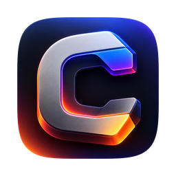
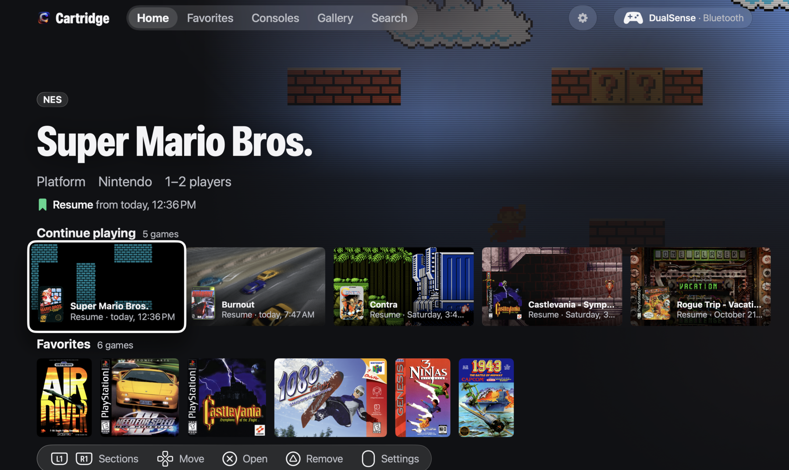
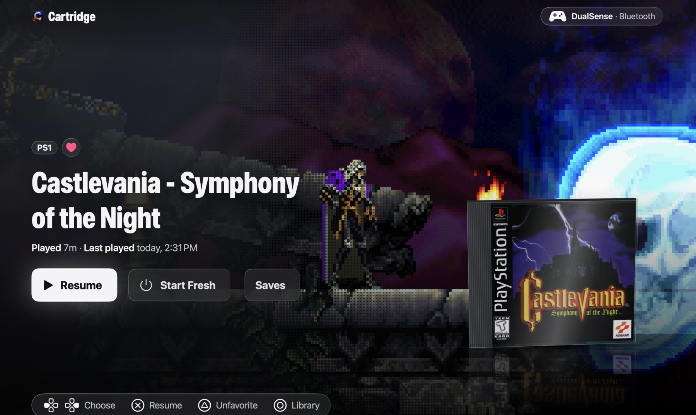
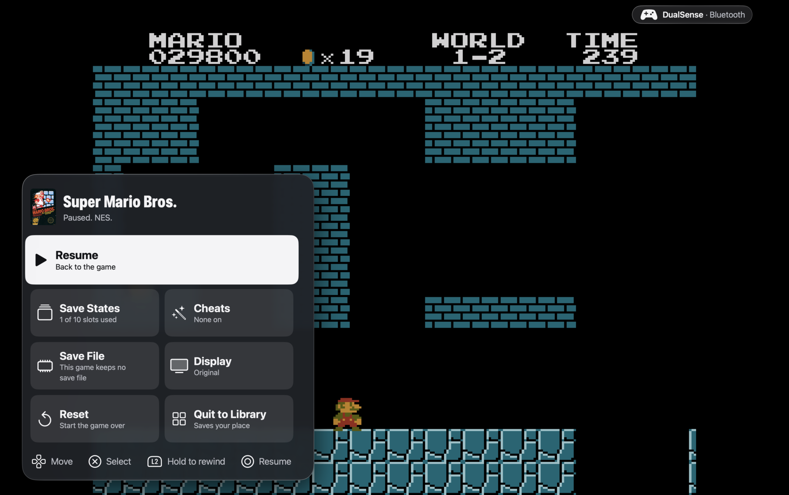

<p align="center">
  
</p>

<h1 align="center">Cartridge</h1>

<p align="center">
  Your retro library, on your Mac, from the couch.<br>
  NES, SNES, Genesis, N64, PlayStation and the original Xbox, played entirely from a PS5 DualSense over Bluetooth.
</p>

<p align="center">
  <a href="https://github.com/ul0gic/cartridge/releases/latest"></a>
  
  
  <a href="LICENSE"></a>
</p>

<p align="center">
  <a href="https://ul0gic.github.io/cartridge/">ul0gic.github.io/cartridge</a>
</p>

<p align="center">
  
</p>

Point Cartridge at a folder of games you own. It identifies every one against the No-Intro and Redump databases, pulls box art, and lays your collection out like a streaming app. Pick a game, and the cartridge slides into the console, the screen goes dark, and the game fills the display. Press the touchpad and a hub slides up: save slots, rewind, cheats, capture. Quit, and next time it opens exactly where you left off.

Every screen is driven from the controller. Nothing asks you to find the mouse.

## Why

A DualSense paired over Bluetooth is the way a Mac feels like a console: no cable, one button to wake it, haptics and all. In some front ends on macOS 26 and later, that controller enumerates with a full button list and then sends nothing. Cartridge talks to the DualSense directly over Bluetooth and USB, and the whole app, library through gameplay, was built for that pad first.

The other half is the experience. Emulators have spent twenty years looking like settings dialogs. Cartridge looks like your TV.

## What you get

<p align="center">
  
</p>

**A library that builds itself.** Choose a folder. Cartridge identifies every game by checksum or disc serial against the No-Intro and Redump databases, names it properly, fetches its box art and sorts it by console. Home shows Continue playing, Favorites and each console's row; Search finds anything in a few letters from the pad. Your folder is never written to.

**A game panel you'll want to look at.** The box art is a real case with a spine and depth, standing on a reflective floor; tilt it with the right stick. Once you've played, your last frame is the backdrop, with time played and when. Press Play and the cartridge or disc goes into its console before the screen hands over to the game.

**Play that gets out of the way.** Full screen, Game Mode, every game in its own helper process on a real-time thread, so a crashed core costs you that game and nothing else. Quit any time; the next launch resumes exactly there, with Start over one press away.

**The hub.** Click the touchpad in a game and the hub slides up:

- Resume, or Start fresh.
- Ten save slots with thumbnails.
- Rewind and fast-forward on L2 and R2 (NES, SNES, Genesis), or from the hub.
- Cheats: the libretro collection for your game, plus a code pad for your own.
- Battery-save backup, restore and import, so a decade-old save file keeps working.
- Three looks: Original, Sharp and CRT.

**Capture and the Gallery.** Hold Create for the capture menu: a screenshot, a recording, or the last 30 seconds you just played. Everything lands in the Gallery, where you play recordings back, turn any clip into a GIF ready to post, reveal files in the Finder, or delete them, all from the controller.

**A shell that knows its consoles.** Each system brings its own colours and hardware into the frame; the Consoles page is a ring of machines you spin. Reduce Motion is honoured throughout.

<p align="center">
  
</p>

## Systems

| System | Engine | You bring |
|---|---|---|
| NES | Mesen | ROMs |
| Super Nintendo | Snes9x | ROMs |
| Sega Genesis | Genesis Plus GX | ROMs |
| Nintendo 64 | Mupen64Plus-Next | ROMs |
| PlayStation | Beetle PSX (Mednafen) | Discs (`.cue`/`.bin`, `.chd`, `.pbp`; `.m3u` for multi-disc) and your BIOS dump (`scph5500`, `scph5501` or `scph5502`) |
| Xbox | xemu 0.8.139, built from source and run headless in its own helper | Discs (Redump or XISO) and your own firmware dumps: the MCPX 1.0 boot ROM and a Complex 4627 flash BIOS |

BIOS and firmware are imported inside the app and stored in your Library folder. Cartridge never bundles or downloads them.

N64 and Xbox have no rewind (state saves cost too much per frame to keep a rewind buffer), and Xbox has no fast-forward or cheats yet.

## The controller

Cartridge supports the DualSense over Bluetooth and USB, including the touchpad click and the Create button. The full guide, with first-time tips, is in Settings.

| | In the library | In a game |
|---|---|---|
| Left stick / D-pad | Move | D-pad and left stick |
| Right stick | Tilt the game box | Right stick |
| Cross / Circle | Select / Back | A / B (NES: Cross jumps, Square or Circle runs) |
| Square / Triangle | Triangle: favourite, or remove from Continue playing | X / Y |
| L1 / R1 | Switch page | Shoulder buttons |
| L2 / R2 | | Hold to rewind / fast-forward (NES, SNES, Genesis; from the hub on N64 and PS1) |
| Touchpad click | | Pause and open the hub |
| Create | | Hold to capture, tap for Select |
| Options | Settings | Start |

Xbox maps its own pad: L2/R2 are the triggers, L1/R1 the white and black buttons, Create is Back.

## Install

1. Download the latest `Cartridge-<version>.dmg` from [Releases](https://github.com/ul0gic/cartridge/releases/latest).
2. Open it and drag Cartridge to Applications. The app and the disk image are signed with a Developer ID and notarized, so they open without warnings.
3. Open it from the Dock, Launchpad or Finder (that's what gets you Game Mode), pair your DualSense, and pick your games folder.
4. For PlayStation or Xbox, import your BIOS or firmware when the app asks for it, or from Settings.

Requirements: an Apple silicon Mac on macOS 27.

### Your games folder

Cartridge reads your games where they are; it doesn't copy them, and it never writes to the folder. Choose one folder and Cartridge looks through it and every folder inside it. Each game is recognised by its file type and checksum, so folder names and layout don't matter: one folder with everything mixed together works as well as a folder per console.

| System | Files |
|---|---|
| NES | `.nes` |
| Super Nintendo | `.sfc`, `.smc` |
| Sega Genesis | `.md`, `.gen`, `.smd`, `.bin` |
| Nintendo 64 | `.z64`, `.v64`, `.n64` |
| PlayStation | `.cue` with its `.bin` tracks in the same folder, `.chd`, `.pbp`; an `.m3u` playlist joins the discs of a multi-disc game |
| Xbox | `.iso`, `.xiso` |

Cartridge games can also be zipped, one game per `.zip`. A game that isn't in the No-Intro or Redump databases still shows up, under its file name and without box art. When you add games later, choose Rescan in Settings.

If you want a tidy layout, one folder per console works well:

```
Games/
  NES/
  SNES/
  Genesis/
  N64/
  PS1/
  Xbox/
```

### Where your data lives

| What | Where |
|---|---|
| Library index, box art, save states, battery saves, imported BIOS and firmware, Xbox drives | `~/Library/Application Support/Cartridge/` |
| Screenshots and recordings | the Gallery inside that folder |
| Logs (plain text: what was played and how it performed) | `~/Library/Logs/Cartridge/` |
| Your own cheat files | `~/Library/Application Support/Cartridge/Cheats/<system>/*.cht` |

No account, no telemetry, no analytics. The app's one network destination is `thumbnails.libretro.com`, for box art.

## Build from source

You need Xcode 27.1, `xcodegen`, `python3`, and for the Xbox engine `ninja`, `pkgconf`, `cmake` and Homebrew's `python@3.13` with PyYAML. Builds are signed with a Developer ID; put your own team in `Cartridge/project.yml` (`DEVELOPMENT_TEAM`) or sign ad hoc for local use.

```sh
python3 Cartridge/Scripts/fetch-cores.py                       # the five libretro cores, verified against Cartridge/Cores/CORES.md
PYTHON=/opt/homebrew/opt/python@3.13/bin/python3.13 Cartridge/Xemu/build-xemu.sh   # xemu as libxemu.dylib
xcodegen generate --spec Cartridge/project.yml --project Cartridge --quiet
xcodebuild -project Cartridge/Cartridge.xcodeproj -scheme Cartridge -configuration Debug \
  -destination 'platform=macOS,arch=arm64' -derivedDataPath .build/DerivedData build -quiet
open .build/DerivedData/Build/Products/Debug/Cartridge.app
```

The Xcode project is generated; never commit `Cartridge/Cartridge.xcodeproj`. Warnings are errors, and every Swift file passes `swiftformat --lint` and `swiftlint --strict`.

| Folder | Contents |
|---|---|
| `Cartridge/App/` | The app: Swift 6, SwiftUI with AppKit where it earns its place |
| `Cartridge/CoreHost/` | The XPC helper that runs one libretro core per game |
| `Cartridge/XboxHost/` | The XPC helper that runs xemu |
| `Cartridge/Xemu/` | How xemu is built: pinned version, patches, overlay, licence manifest |
| `Cartridge/Shared/` | Code and the shared-memory header compiled into every target |
| `Cartridge/Scripts/` | Core, database, cheat and licence fetchers; signing scripts |

## Questions and bugs

Open an [issue](https://github.com/ul0gic/cartridge/issues). When something goes wrong in play, attach the session log from `~/Library/Logs/Cartridge/`; it holds the frame timing and the emulator's own messages.

## Licence

Cartridge is free software under the [GNU General Public License v3.0](LICENSE). Copyright © 2026 CORELIFT LLC.

Third-party components, each under its own licence (texts in `Cartridge/App/Resources/Licenses/` and in About):

- Emulation: Mesen, Snes9x, Genesis Plus GX, Mupen64Plus-Next and Beetle PSX through libretro (Snes9x and Genesis Plus GX are non-commercial); [xemu](https://xemu.app) (GPL-2.0), built from source with the patches in `Cartridge/Xemu/patches/`, its exact source attached to every release as `Cartridge-<version>-xemu-src.tar.gz`.
- Data: game identification from [libretro-database](https://github.com/libretro/libretro-database) (CC BY-SA 4.0), cheats from its `cht` collection, box art from [libretro-thumbnails](https://github.com/libretro-thumbnails).
